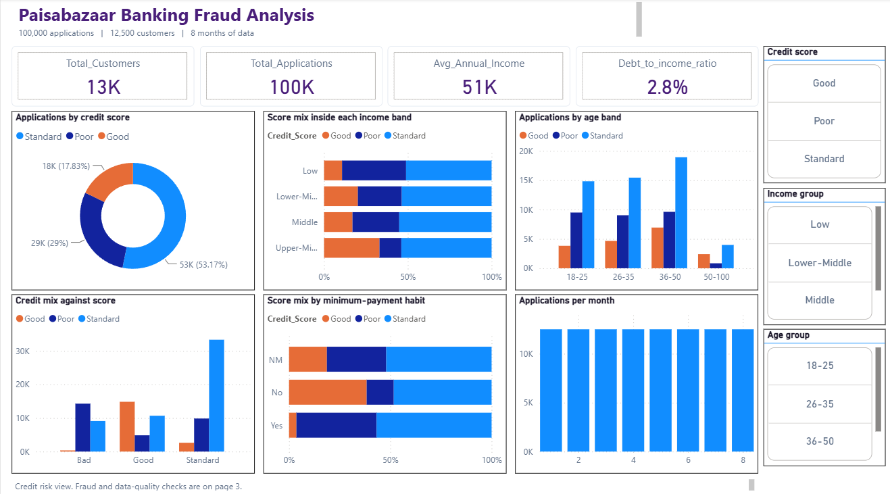

# Paisabazaar Banking Fraud Analysis

A capstone project on a credit bureau dataset from Paisabazaar: what in a customer's profile actually separates a **Good** credit score from a **Poor** one, and how much of the data can be trusted at all.

The work is a Python notebook (EDA plus a baseline model) and a Power BI report.



---

## What's in this repo

| Path | What it is |
|---|---|
| `Paisabazaar_Banking_Fraud_Analysis_Capstone_Project.ipynb` | The main notebook. 99 cells, 10 charts, runs start to finish with no errors. |
| `dataset.csv` | The source data. 100,000 rows, 28 columns, 30 MB. |
| `Paisabazaar_Fraud_Dashboard.pbix` | Power BI report. 3 pages, 32 visuals. |
| `dashboard-preview.png` | Screenshot of page 1 of the Power BI report. |

Project type: **EDA**. Contribution: **Individual**. Author: **Yogesh Kumar**.

---

## The problem

Paisabazaar is a lending marketplace. A customer fills in one application, Paisabazaar passes it to partner banks, and the banks decide whether to lend. Part of that decision is the credit score a bureau predicts for that customer. Two questions follow from that:

1. **What in a customer's profile actually moves the score?** If a person wants a better score, which numbers should they work on and which ones make no difference?
2. **How much of this data is a real customer?** Banks lose money to identity fraud, so the second question is whether one person is hiding behind many records.

The notebook answers both from the data. The dashboard puts the answers on one screen for a business audience.

---

## The data

| Group | Columns |
|---|---|
| Identity | `ID`, `Customer_ID`, `Month`, `Name`, `Age`, `SSN`, `Occupation` |
| Income | `Annual_Income`, `Monthly_Inhand_Salary`, `Monthly_Balance` |
| Credit lines | `Num_Bank_Accounts`, `Num_Credit_Card`, `Num_of_Loan`, `Type_of_Loan`, `Credit_History_Age` |
| Borrowing cost | `Interest_Rate`, `Outstanding_Debt`, `Total_EMI_per_month`, `Amount_invested_monthly` |
| Behaviour | `Delay_from_due_date`, `Num_of_Delayed_Payment`, `Num_Credit_Inquiries`, `Credit_Mix`, `Credit_Utilization_Ratio`, `Payment_of_Min_Amount`, `Payment_Behaviour`, `Changed_Credit_Limit` |
| Target | `Credit_Score` (Good / Standard / Poor) |

The data arrives messy on purpose, the way real bureau exports do. Cleaning is a full section of the notebook, not a footnote.

---

## Key findings

### 1. The classes are lopsided

| Score | Rows | Share |
|---|---:|---:|
| Standard | 53,174 | 53.2% |
| Poor | 28,998 | 29.0% |
| Good | 17,828 | 17.8% |

So any model that always answers "Standard" is right 53.4% of the time. That is the number to beat. Every accuracy figure below is measured against it.

### 2. Debt is the biggest divider

Average outstanding debt by score:

| Good | Standard | Poor |
|---:|---:|---:|
| 801.26 | 1,278.42 | 2,081.47 |

A Poor customer carries **2.6x** the debt of a Good one. Nothing else in the dataset separates the groups this cleanly.

### 3. The behaviour numbers move together

| Measure | Good | Standard | Poor |
|---|---:|---:|---:|
| Days delayed from due date | 10.96 | 19.76 | 29.73 |
| Interest rate on the loan | 7.66 | 13.75 | 20.19 |
| Credit enquiries | 3.30 | 5.34 | 8.18 |
| Number of loans | 2.20 | 3.31 | 4.76 |
| Annual income | 65,204 | 50,987 | 40,585 |
| Age | 36.40 | 33.44 | 31.19 |

Read it as one story: paying late leads to a higher interest rate, a higher rate leads to more debt, more debt leads to more enquiries and more loans. The score is picking up a habit, not a single number.

### 4. The trap: utilization does not move at all

| Good | Standard | Poor |
|---:|---:|---:|
| 32.69 | 32.31 | 31.99 |

Credit utilization is the number most people expect to drive a score, and here it is flat across all three classes. Correlation with the score is **+0.046**. People who say "keep your utilization under 30%" are not wrong in general, but in this dataset that advice explains nothing. A good analysis has to be willing to report the flat line.

Same story with **occupation**: average debt sits between 1,343 and 1,486 across all 15 job types. Job title does not predict credit behaviour here.

### 5. Correlations with the score

| Positive | r | Negative | r |
|---|---:|---|---:|
| Credit_Mix | +0.499 | Interest_Rate | −0.485 |
| Annual_Income | +0.213 | Num_Credit_Inquiries | −0.435 |
| Monthly_Inhand_Salary | +0.210 | Delay_from_due_date | −0.431 |
| Monthly_Balance | +0.198 | Payment_of_Min_Amount | −0.415 |
| Age | +0.160 | Num_Credit_Card | −0.404 |
| Credit_Utilization_Ratio | +0.046 | Num_Bank_Accounts | −0.388 |
| Total_EMI_per_month | +0.017 | Outstanding_Debt | −0.387 |
| | | Num_of_Loan | −0.358 |

`Credit_Mix` is the strongest single signal in the dataset. It is also the one a customer can fix fastest: it is a mix of loan types, not a history of them.

### 6. Outliers: 22.9% of rows, all on the high side

IQR check across 15 numeric columns found **22,919 rows (22.9%)** flagged in at least one column. Every single flag was above the upper fence. No low-side outliers at all, which tells you these are not data entry errors but the real long tail of debt.

| Column | Rows flagged |
|---|---:|
| Monthly_Balance | 7,400 |
| Outstanding_Debt | 5,272 |
| Total_EMI_per_month | 5,044 |
| Amount_invested_monthly | 4,464 |
| Delay_from_due_date | 4,002 |
| (4 more) | smaller |

6 of the 15 columns were clean. I **kept** the outliers rather than removing or capping them. A customer with 5,000 in debt is not a mistake, and deleting 23% of the rows would delete exactly the people the risk team cares most about. The notebook says this in plain words.

### 7. Five data problems, and two things that came out clean

| Problem | Size |
|---|---|
| `Age` under 18, minimum 14 | 5,868 rows |
| Credit history longer than the person has been alive | 11,824 rows |
| Distinct `Type_of_Loan` strings (loans chained into one text field) | 6,261 |
| `Payment_of_Min_Amount` = `NM` (not measured) | 12,007 rows, 12.0% |
| `Annual_Income` and `Monthly_Inhand_Salary` are the same column twice | r = 0.998 |

Clean: no duplicate rows, and no missing `Credit_Score`. Both are worth checking and both pass.

`NM` is kept as its own class called **Unknown**, not merged into `No`. Merging them looks tidy and inflates the non-payment rate from 35.7% to 47.7%, which is a fabricated finding.

One more thing the cleaning section surfaced: **58.3% of customers change their credit score at least once across the 8 months**, while most of the columns that predict the score do not change at all in that time. So a single month is a shaky reading, and the notebook recommends taking the score over two or three months before a lending decision.

### 8. Fraud check: one name, many identities

| Measure | Count |
|---|---:|
| Distinct names | 10,128 |
| Names holding 2 to 6 different SSNs | 1,829 (18.1%) |
| Resulting identity records | 4,201 |
| Rows affected | 33,608 (33.6%) |

Someone with two SSNs can be a clerical duplicate. Someone with six is a pattern. The check is built from `Name` + `SSN` only, because a name should map to one person and an SSN to one name. The notebook reports the count without dressing it up.

---

## The model

A logistic regression as a **baseline**, not as a production model. Its job is to prove the patterns above survive being fitted, not to predict credit scores.

| | Score |
|---|---:|
| Baseline (always "Standard") | 53.40% |
| Model, split by `Customer_ID` | **68.40%** |
| Gain over baseline | +15.00 pts |
| Model, split by row (wrong way) | 78.10% |

**Why the split matters.** The dataset has 12,500 customers over 8 months, so the same person shows up 8 times. Shuffle rows and the model sees seven months of a customer in training and the eighth in test. It memorises the person and scores 78.10%. Group the split by `Customer_ID` and that leak closes: **68.40%**. The notebook shows both numbers and explains why the lower one is the honest one.

Per-class recall on the group split:

| Class | Correct | Total | Recall |
|---|---:|---:|---:|
| Poor | 4,790 | 7,246 | 66.1% |
| Standard | 9,545 | 13,349 | 71.5% |
| Good | 2,764 | 4,405 | 62.7% |

Worst cell in the confusion matrix: **1,523 Good customers predicted Standard** (34.6% of all Good rows). The model is cautious about the top class, which is the right direction to fail in for a lender but worth knowing.

Feature importance agrees with the EDA, which is the point:

| Feature | Importance |
|---|---:|
| Outstanding_Debt | 0.124 |
| Monthly_Balance | 0.094 |
| Credit_Utilization_Ratio | 0.091 |
| Interest_Rate | 0.090 |
| Credit_Mix | 0.085 |

---

## The dashboard

`Paisabazaar_Fraud_Dashboard.pbix`, built on the same CSV. Three pages, 32 visuals.

| Page | Visuals | What it answers |
|---|---:|---|
| Overview | 16 | How big is the book, how is it split, where is the risk concentrated |
| What drives the score | 9 | Which measures actually separate Good from Poor |
| Risk segments | 7 | Who to look at first, and how much of the book they are |

The KPI cards shorten large numbers (50,987 shows as 51K) because the card visual compacts them. The exact figures are printed in the header text of each page so nothing is lost.

---

## How to run

```bash
pip install -r requirements.txt
jupyter notebook "Paisabazaar_Banking_Fraud_Analysis_Capstone_Project.ipynb"
```

Run the cells top to bottom. The notebook reads `dataset.csv` from the same folder and runs end to end without errors, ending with the model results.

**Power BI:** open the `.pbix` and everything is already loaded, no refresh needed. If you do refresh, point the CSV source at `dataset.csv` in this folder, because the saved path is my local machine.

---

## Choices I made, and why

| Choice | Reason |
|---|---|
| Kept `NM` as `Unknown` | Merging into `No` inflates non-payment from 35.7% to 47.7%. That is a fake number. |
| Kept the outliers | 22.9% of rows, all high-side. These are the risky customers, not errors. |
| Split by `Customer_ID` | Row splits let the model memorise a person across months and score 78.10%. The real number is 68.40%. |
| Reported the flat lines | Utilization and occupation do not move the score here. Saying so is more useful than hiding it. |
| Simple model, not tuned | A baseline that beats 53.4% by 15 points proves the patterns. A tuned model would only prove the tuning worked. |

---

## License

The dataset is a public Paisabazaar capstone dataset, shared here for learning. Code is free to reuse.
